<h1 align="center">Hey, I'm Rohit Sonawane</h1>
<h3 align="center">CS Undergrad · Systems Builder · Works on My Machine™</h3>

  

## About

Third-year Computer Engineering student at PCCoE (Pimpri Chinchwad College of Engineering).

I build backend-heavy systems where AI agents, distributed systems and data structures meet. I like projects I can run and debug myself, usually at 1 AM.

Right now I'm working on [Scrutin](https://github.com/RohitDSonawane/Scrutin), a multi-agent platform that verifies claims. Six agents investigate a claim or URL, an adversarial verifier on a separate model provider tries to break the provisional verdict, and the result comes back with a calibrated confidence score.

## What I'm working on

- Scrutin: multi-agent misinformation verification with FastAPI, React and Pydantic AI
- Exploring agentic AI, blockchain and Web3, and system design
- CGPA and I have reached a mutual understanding. We're working on it.
- Ask me about Python, C++, LLM pipelines, LangChain and LangGraph, agent dev kits, and Hyperledger
- Reach me at [rohit.sonawane.works@gmail.com](mailto:rohit.sonawane.works@gmail.com)

## Selected work

| Project | What it does | Stack |
|---|---|---|
| [Scrutin](https://github.com/RohitDSonawane/Scrutin) | Verifies a claim or URL with six agents and an adversarial verifier, and returns a verdict with a calibrated confidence score. | Python, FastAPI, React, Pydantic AI |
| [MailMind](https://github.com/RohitDSonawane/Mailmind) | Scheduling assistant that lives in email threads. It reads availability written in plain English, finds the overlap and books the Google Calendar event. | Python, Pydantic AI, Groq, Gmail IMAP/SMTP, Google Calendar |
| [Turing Machine Arithmetic Simulator](https://github.com/RohitDSonawane/turing-machine-arithmetic-simulator) | Animated Turing machines doing binary increment, addition and multiplication, tied to ALU hardware. [Live demo](https://rohitdsonawane.github.io/turing-machine-arithmetic-simulator/). | JavaScript, no build step |
| [Disaster Evacuation System](https://github.com/RohitDSonawane/DisasterEvacuationSystem) | Dijkstra routing and capacity-limited shelter allocation, with a dashboard prototype. | C++17, Next.js |
| [Hyperledger Fabric car supply chain](https://github.com/RohitDSonawane/hyperledger-fabric-car-supply-chain) | Tracks vehicle provenance from manufacture to sale across a multi-org Fabric network. | Hyperledger Fabric, Go, Shell |

## Skills

Languages

       

Backend and data

      

Frontend and design

   

AI and blockchain

   

Tools

  

## Connect

  

<i>works on my machine™</i>

